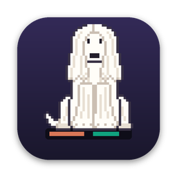
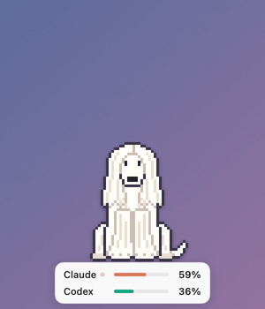
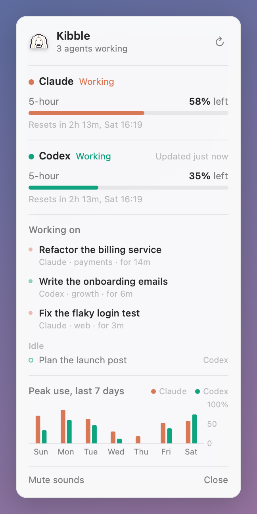
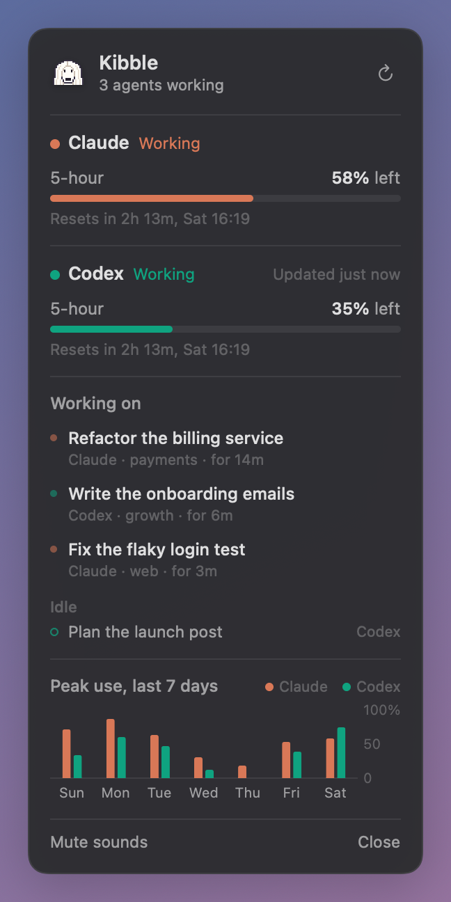
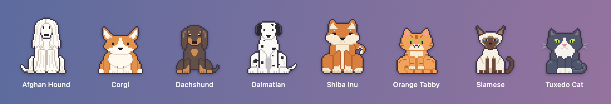

<p align="center">
  
</p>

<h1 align="center">Kibble</h1>

<p align="center">
  A pixel-art Afghan hound that sits in the corner of your Mac<br>
  and keeps an eye on how much Claude and Codex you have left.
</p>

<p align="center">
  
</p>

## What it does

Kibble lives in the bottom-right corner of your screen, above every window. Underneath it sits a small stage with one line per provider, showing how much of your plan is left in the tightest window.

- **Usage left.** Claude's rolling 5-hour and weekly limits, and Codex's limits, with reset times.
- **What's being worked on.** It notices every Claude Code and Codex session on your machine and lists the tasks in progress by title, with where they run and for how long. Click a task to jump to it: the Claude session, the Codex thread, the terminal tab or the project folder. While one works, the pet runs; when nothing has happened for five minutes, it naps.
- **Done and waiting.** When a task finishes, the pet hops and says so. When an agent is blocked on you (a permission prompt, or a question it asked), it keeps asking for attention until you answer or click it.
- **Where your usage is heading.** At the current pace, the card tells you when a window will run out ("At this pace: empty around 15:40") and charts the last seven days. History stays in `~/Library/Application Support/Kibble`.
- **It barks.** A soft woof at 75%, a bark at 90%, a howl at 100%, and a happy yip when a window resets. Each comes with a macOS notification, and sounds can be muted.
- **It likes attention.** Double-click to pet it. Drag it anywhere; drop it near a corner and it snaps into place. It remembers where you left it and turns to face the screen.

Click the hound for the detail card:

<p align="center">
  
  
</p>

## Pick a pet

Kibble comes with eight pets, each with its own idle, bark (or meow), petting, running and sleeping animations. Dogs woof, bark and howl; cats mew, meow, yowl and purr. Choose one from **Pet** in the menu bar menu or by right-clicking the pet.

<p align="center">
  
</p>

There is also a menu bar item with the percentages, plus a menu for size, mute, position and a demo mode for screen recordings.

## Install

Requires macOS 14 or later and Xcode 15.3 or later.

```bash
git clone https://github.com/znel2002/kibble.git
cd kibble
./scripts/build-app.sh
open build/Kibble.app
```

To keep it, move `build/Kibble.app` to `/Applications`. `./scripts/build-app.sh --dmg` also produces a disk image.

## How it reads your usage

Everything stays on your Mac. Kibble has no server and no analytics.

| | Limits | Agents |
|---|---|---|
| **Claude** | Anthropic's account usage endpoint (`/api/oauth/usage`), authenticated with the token Claude Code already stores in your login keychain. Kibble only reads the token; it never refreshes or saves it. Polled every 90 seconds. | `~/.claude/sessions/*.json`, which Claude Code keeps for every live session, with its status. |
| **Codex** | The `rate_limits` that Codex writes into its session logs in `~/.codex/sessions`. No network access. The numbers are as fresh as your last Codex turn. | Recently written session logs, and whether their last turn has finished. |

You need to be signed in to Claude Code with a subscription (Pro, Max, Team or Enterprise) and to have used Codex at least once. The Claude endpoint isn't a public API, so it may change; if it does, Kibble shows the error instead of guessing.

## Development

```bash
swift build          # debug build
swift test           # parsers, alert thresholds, sprites
.build/debug/Kibble --snapshot docs           # render the widget and card to PNGs
.build/debug/Kibble --snapshot docs --frames  # plus the frames behind demo.gif
```

Each pet is one Python file in [`tools/pets/`](tools/pets), drawn with the small toolkit in [`tools/pixelkit.py`](tools/pixelkit.py): layered ASCII parts (tail, legs, coat, head, ears) that each get their own outline and are stacked back to front, with front-facing sitting poses drawn as one half and mirrored. To add a pet, copy one of the existing files, then check it with `python3 tools/pixelkit.py preview <id>`, which validates the frames and writes a contact sheet to `docs/pets/`. `python3 tools/sprites.py` exports every pet to `Sources/Kibble/Sprites.generated.swift` and regenerates the app and menu bar icons (it needs Pillow). Sounds are synthesised at launch in [`Sound.swift`](Sources/Kibble/Sound.swift), so the repo has no audio files.

## Credits

Made by [Kim Harre](https://github.com/znel2002). Not affiliated with Anthropic or OpenAI; Claude and Codex are their respective trademarks.

MIT licensed.
